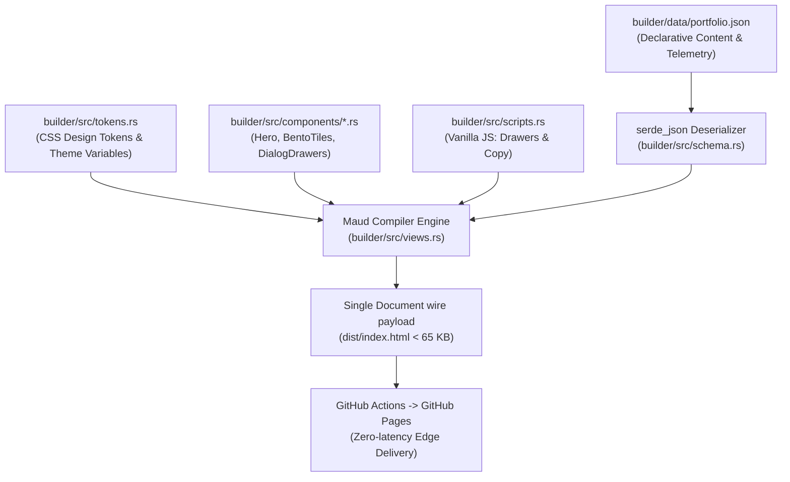

# Technical Design: Bento-Grid & Interactive Showcase Portfolio Overhaul

* **Author**: ROOT::OMNISCIENT
* **Status**: Approved
* **Date**: 2026-11-01
* **Target Workspace**: `portfolio` (`builder/` Rust Maud Static Site Pipeline)

---

## 1. Overview & Problem Statement

### 1.1 The Problem
The current portfolio presentation suffers from structural and visual limitations:
1. **Low Scanning Efficiency**: Case studies are laid out in a repetitive vertical stack with rigid two-column sub-sections ("The Challenge" and "How I Solved It"). Technical recruiters and hiring managers spend an average of 15–30 seconds reviewing a portfolio; dense paragraph blocks force high cognitive load rather than immediate comprehension of system impact.
2. **Monolithic Architecture**: All Maud HTML macros, inline CSS strings (1,100+ lines), and inline JavaScript reside in a single 1,639-line file (`builder/src/main.rs`). Iterating on design systems, component tokens, or layout variants requires recompiling a monolithic source file, increasing regression risk.
3. **Offsite Navigation Friction**: Inspecting project details currently requires clicking external GitHub links. There is no inline mechanism to explore system architecture, operational trade-offs, or benchmarks without leaving the site.
4. **Contrast & Theme Deficiencies**: Several token combinations fail WCAG 2.1 AA 4.5:1 contrast requirements, and the site lacks dark mode support (`prefers-color-scheme`).

### 1.2 Overview
This project redesigns the developer portfolio into an asymmetrical **Bento-Grid & Interactive Showcase**. The interface organizes technical competencies, production telemetry, and engineering case studies into high-contrast modular bento tiles. Detailed project breakdowns are accessible directly on-page using zero-dependency native HTML `<dialog>` drawers, supported by a modularized Rust Maud build engine.

### 1.3 Goals
* **Modular Bento Grid**: Structure the layout into responsive visual containers (Hero, Production Case Studies, Capabilities Matrix, Now Ledger, Contact Banner) that adapt cleanly across mobile (single-column), tablet (2-column), and desktop (multi-span grid).
* **Zero-Dependency Interactive Drawers**: Provide detailed architectural case study drill-downs using native `<dialog>` elements, keyboard accessibility (`Esc` to close), and minimal vanilla JavaScript (< 1.5 KB wire size).
* **Rust Engine Modularization**: Decouple `builder/src/main.rs` into distinct modules: `tokens.rs` (CSS design variables), `components.rs` (reusable Maud macro templates), and `views.rs` (section assemblies).
* **Strict Performance Budget**: Retain single-request HTML delivery with total raw wire payload under 65 KB uncompressed, achieving 100/100 Core Web Vitals and zero render-blocking third-party scripts.
* **Dual-Mode WCAG AA Accessibility**: Implement high-contrast light and dark themes toggled via CSS variables and `prefers-color-scheme`, ensuring minimum 4.5:1 contrast for all text elements.

### 1.4 Non-Goals
* **No Client-Side Frameworks**: Do not adopt React, Vue, Svelte, or Tailwind build runtimes.
* **No Server-Side State or Dynamic APIs**: Maintain zero-infrastructure deployment via GitHub Pages and GitHub Actions.
* **No Arbitrary CMS Layer**: Content remains declaratively managed in `builder/data/portfolio.json`.

---

## 2. Technical Plan

### 2.1 High-Level Architecture & Pipeline
The generation pipeline remains purely static and compile-time evaluated. The monolithic `builder/src/main.rs` is decomposed into modular compilation units.



### 2.2 Component & Layout Architecture

#### A. Bento-Grid Layout System
The layout replaces the repetitive vertical stack with an asymmetrical, responsive CSS Grid:
* **Hero Tile (Span: 2 col, 2 row)**: Large display typography, active role indicator, live status beacon, and primary contact action buttons.
* **Featured System Case Study (Span: 2 col, 2 row)**: Top-tier infrastructure project (e.g. Terraform & Prometheus Multi-Node Platform) featuring architecture telemetry metrics and a "Deep-Dive Architecture" drawer trigger.
* **Secondary System Case Study (Span: 1 col, 1 row)**: Focused AI model training / server agent project with direct drawer trigger.
* **Now Ledger Tile (Span: 1 col, 1 row)**: Live engineering focus, current research topics, and timezone availability.
* **Capabilities Matrix (Span: 2 col, 1 row)**: Grid of categorized skill items with hover metadata.
* **Interactive Spark Banner (Span: 3 col / full-width)**: Low-friction contact banner with copy action and outbound social links.

#### B. Responsive Breakpoint Rules
* **Desktop (min-width: 1024px)**: `grid-template-columns: repeat(3, 1fr)` with explicit `grid-column` and `grid-row` spans.
* **Tablet (641px – 1023px)**: `grid-template-columns: repeat(2, 1fr)`. Tiles gracefully collapse to 2-column flow.
* **Mobile (max-width: 640px)**: `grid-template-columns: 1fr`. Automatic single-column linear flow with full-width cards.

### 2.3 Interactive Project Drawers (`<dialog>`)
To allow deep architectural review without offsite redirection, each case study renders an associated native `<dialog>` element:
* **Semantic Structure**: `<dialog id="drawer-{id}" class="project-drawer" aria-labelledby="title-{id}">` containing:
  - Technical Challenge & Root Cause.
  - Architecture Diagram (pre-formatted SVG or ASCII block).
  - Implementation Decisions & Quantitative Impact metrics.
  - Links to repository configs.
  - Fixed dismiss button `<button class="drawer-close" aria-label="Close dialog">✕</button>`.
* **Behavior & Script Payload**:
  - Open: Event delegation on `.js-open-drawer` listening to clicks, calling `dialog.showModal()`.
  - Close: Native backdrop click listener (`e.target === dialog`) and close button listener, calling `dialog.close()`. Native `Esc` key handling is provided out of the box by the browser.
  - Total client JavaScript overhead: **< 1.2 KB**.

### 2.4 Rust Codebase Modularization
The file hierarchy inside `builder/` is restructured as follows:

```text
builder/
├── Cargo.toml
├── data/
│   └── portfolio.json
└── src/
    ├── main.rs         # CLI entry point, workspace resolution, file I/O
    ├── schema.rs       # Serde structs (Profile, Project, Domain, Contact)
    ├── tokens.rs       # CSS custom properties, typography scales, light/dark themes
    ├── scripts.rs      # Inlined, parameter-bound vanilla JS (< 1.5 KB)
    ├── components/
    │   ├── mod.rs
    │   ├── nav.rs      # Header navigation and theme toggle
    │   ├── hero.rs     # Hero display tile
    │   ├── bento.rs    # Bento grid tile wrappers
    │   ├── drawer.rs   # Modal dialog markup generator
    │   └── footer.rs   # Footer and dynamic metadata
    └── views.rs        # Main HTML document assembler (render_page)
```

### 2.5 Theme System & WCAG 2.1 AA Contrast
Dual-mode theming is implemented via CSS custom properties on `:root` and `[data-theme="dark"]`, with automatic `prefers-color-scheme: dark` fallback:
* **Backgrounds**: Light (`#f8fafc` / `#ffffff`) | Dark (`#090d16` / `#0f172a`).
* **Text / Ink**: Light (`#0f172a` primary, `#334155` secondary) | Dark (`#f8fafc` primary, `#94a3b8` secondary).
* **Borders**: Light (`#e2e8f0`) | Dark (`#1e293b`).
* **All body text and interactive controls maintain a contrast ratio >= 4.5:1 against their respective card surfaces.**

---

## 3. Alternatives Considered

### 3.1 Alternative 1: Client-Side Framework (React / Next.js / Astro)
* **Description**: Rebuilding the portfolio front-end using a modern JavaScript/TypeScript framework to manage UI state and bento grid animations.
* **Why Rejected**:
  * **Wire Payload Inflation**: Adding a JavaScript framework increases the client wire transfer from ~53 KB to 150 KB–300+ KB due to runtime hydration bundles.
  * **Supply Chain & Toolchain Bloat**: Introduces `package.json`, `node_modules`, npm audit vulnerabilities, and Node.js runtime dependencies to a repository that currently builds cleanly with a single, standalone Rust binary.
  * **Violates Engineering Identity**: For a DevOps and platform systems engineer, presenting a zero-dependency, ultra-fast static artifact compiled in Rust directly demonstrates systems discipline.

### 3.2 Alternative 2: Multi-Page Navigation (`/projects/{id}.html`)
* **Description**: Generating discrete HTML subpages for each project case study instead of on-page modal drawers.
* **Why Rejected**:
  * **Evaluation Latency**: Technical recruiters and engineering managers reviewing candidate portfolios spend 15–30 seconds per profile. Requiring full page transitions and browser back-button navigation adds friction and reduces case study completion rate.
  * **Asset Redundancy**: Multiplying HTML documents requires repeating inlined CSS or establishing external stylesheet caching, increasing total wire payload across multi-page sessions.
  * **Superior Native Primitives**: HTML5 `<dialog>` provides native accessibility, trap focus, and `Esc` dismissal out of the box with zero runtime libraries.

### 3.3 Alternative 3: Terminal / Monospaced Raw Telemetry Aesthetic
* **Description**: Restyling the entire portfolio as a terminal command line or pure monospaced plaintext document.
* **Why Rejected**:
  * **Poor Recruiter Ergonomics**: Pure monospaced layouts create severe visual fatigue for non-technical talent partners and executive stakeholders.
  * **Loss of Hierarchy**: Fails to provide visual contrast between primary infrastructure achievements (e.g., Multi-Node Terraform cloud architecture) and secondary skill tags.

---

## 4. Detailed Implementation Plan

### 4.1 File Operations & Rationale

| Operation | File Path | Rationale |
| :--- | :--- | :--- |
| **Delete** | `styles.css` | Remove 1,268 lines of dead, unreferenced legacy matrix stylesheet. |
| **Delete** | `script.js` | Remove dead legacy matrix-rain script and unreferenced handlers. |
| **Delete** | `docs/CNAME` & `docs/` | Eliminate conflicting DNS domain target (`rootcanvas.pro.bd`) and dead legacy deploy path. |
| **Create** | `.well-known/security.txt` | Establish RFC 9116 compliant plaintext vulnerability disclosure metadata. |
| **Create** | `builder/src/schema.rs` | Extract Serde data models (`Profile`, `Project`, `Domain`, `Contact`) with optional drawer fields (`architecture_summary`, `metrics`). |
| **Create** | `builder/src/tokens.rs` | Define centralized CSS design variables for bento grid geometry, typography scale, and WCAG AA dark/light color systems. |
| **Create** | `builder/src/scripts.rs` | Provide lightweight, parameter-interpolated vanilla JS (< 1.2 KB) for `<dialog>` drawers, keyboard traps, and copy toast. |
| **Create** | `builder/src/components/mod.rs` | Expose modular template components. |
| **Create** | `builder/src/components/nav.rs` | Render sticky header navigation with theme toggle and skip-to-content accessibility link. |
| **Create** | `builder/src/components/hero.rs` | Render high-impact hero bento tile with status beacon and primary actions. |
| **Create** | `builder/src/components/bento.rs` | Render asymmetrical bento container and interactive case study card tiles with badge clusters. |
| **Create** | `builder/src/components/drawer.rs` | Render native HTML5 `<dialog>` modals with architectural breakdowns and close controls. |
| **Create** | `builder/src/components/skills.rs` | Render structured capabilities and domain competencies matrix. |
| **Create** | `builder/src/components/footer.rs` | Render semantic footer dynamically bound to schema profile name and location. |
| **Create** | `builder/src/views.rs` | Assemble complete HTML document (`<!DOCTYPE html>`, `<head>`, meta tags, OpenGraph/Twitter cards, Maud markup). |
| **Modify** | `builder/src/main.rs` | Reduce monolithic 1,639-line file to a clean, deterministic ~100-line CLI build orchestrator and static asset mirrorer. |
| **Modify** | `builder/data/portfolio.json` | Add architecture highlights, technical trade-offs, and telemetry metrics for case study drawers. |
| **Modify** | `security.txt` | Update root mirror to match plaintext RFC 9116 format (remove HTML entity encoding). |

### 4.2 Step-by-Step Execution Sequence

1. **Phase 1: Repository Hygiene & Dead File Pruning**
   * Delete legacy `styles.css`, `script.js`, and `docs/` directory.
   * Create `.well-known/security.txt` with raw plaintext contact email and expiration.

2. **Phase 2: Schema Enrichment**
   * Update `builder/data/portfolio.json` with structured drawer fields for each project:
     - `architecture_summary`: 1–2 sentence operational breakdown.
     - `metrics`: Array of telemetry strings (e.g. `["15s Triage Latency", "99.95% Availability"]`).
     - `trade_offs`: Key design decision and why it was selected.

3. **Phase 3: Modularizing Rust Maud Architecture**
   * Create `builder/src/schema.rs` with strongly-typed Serde structs.
   * Create `builder/src/tokens.rs` implementing CSS grid variables and light/dark theme styles.
   * Create `builder/src/scripts.rs` containing parameterized client JavaScript for modal drawer orchestration.
   * Implement template components under `builder/src/components/`.
   * Implement `builder/src/views.rs` assembling the complete HTML tree.

4. **Phase 4: Build Orchestrator Refactor**
   * Update `builder/src/main.rs` to load `builder/data/portfolio.json`, invoke `views::render_page(&data)`, and mirror assets:
     - `CNAME`
     - `robots.txt`
     - `security.txt`
     - `.well-known/security.txt`
     - `avatar.png`
   * Write generated output to `dist/index.html` and root `index.html`.

5. **Phase 5: Verification & Quality Assurance**
   * Run `cargo run --release --manifest-path builder/Cargo.toml`.
   * Verify wire payload is strictly `< 65 KB`.
   * Validate HTML structure against W3C standards and test `<dialog>` drawer interactions on Chrome/Firefox/WebKit.
